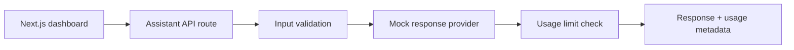

# AI SaaS Starter Kit

A full-stack starter for prototyping an AI-enabled SaaS experience: a responsive dashboard, workspace selector, assistant API, mock-mode responses, and per-workspace usage limits. It runs locally without paid AI services.

> **Prototype scope:** authentication, persistent PostgreSQL storage, billing, and secure tenant isolation are not implemented in this starter. The workspace ID is a demo selector, not an identity boundary. See the production checklist before deploying with real users or data.

## Features
- Next.js App Router + TypeScript dashboard.
- Assistant chat UI with loading and error states.
- API route with deterministic mock responses; no API key required.
- Per-workspace request counter and configurable in-memory usage limit.
- Usage status, reset-on-restart behavior, and API validation.
- Environment example, tests for usage logic, and MIT license.

## Quick start
Requires Node.js 20+ and npm.

```bash
npm install
cp .env.example .env.local
npm run dev
```

Open [http://localhost:3000](http://localhost:3000).

## Configuration
`.env.example` documents:
- `AI_PROVIDER=mock` — default, free deterministic demo.
- `WORKSPACE_MONTHLY_LIMIT=50` — demo request cap per workspace.
- `AI_PROVIDER=ollama` is reserved for a future local-model adapter; it is not active in this version.

## API
`POST /api/assistant`

Request:
```json
{"workspaceId":"demo-workspace","message":"Summarize the benefits of RAG"}
```

The response includes a demo answer and usage metadata. The in-memory usage counter resets when the Node process restarts; do not treat it as billing-grade accounting.

## Architecture


## Commands
```bash
npm run dev
npm run build
npm run start
npm test
```

## Production checklist
Before using this as a real SaaS product, add:
- Authentication and server-verified workspace membership.
- PostgreSQL persistence and migrations.
- Atomic usage accounting, billing integration, and rate limiting.
- Secrets management and a real provider adapter (or a tested local model adapter).
- Tenant-scoped data access, audit logs, observability, and security tests.
- Privacy policy, retention controls, and abuse prevention.

## Implemented vs. next steps
**Implemented:** dashboard, mock assistant endpoint, input validation, usage limit, tests, and local setup.

**Next steps:** PostgreSQL persistence, real authentication, billing, streaming responses, and optional local/hosted LLM provider integration.

## License
MIT — see [LICENSE](LICENSE).
